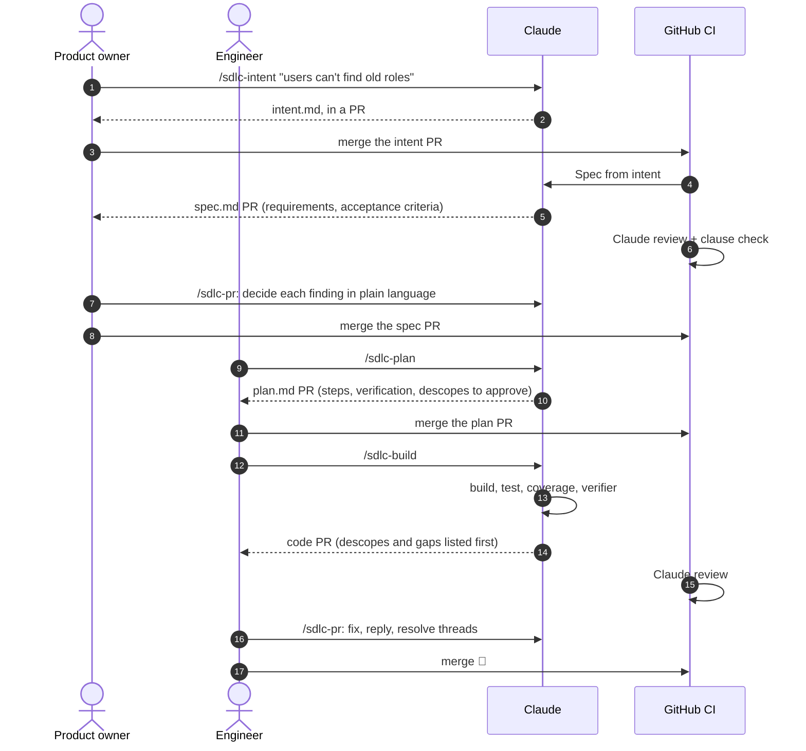
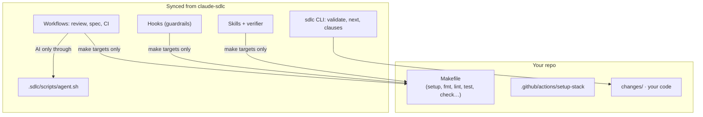
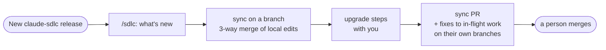

<div align="center">


# claude-sdlc

**Ship software with Claude, without giving up control.**

A ready-to-use delivery pipeline that turns an idea into a reviewed, tested pull request: Claude does the drafting, building and checking, and people make every decision that matters.

[](https://github.com/stickleprojects/claude-sdlc/releases/latest)
[](https://github.com/stickleprojects/claude-sdlc/actions/workflows/sdlc-ci.yml)

</div>

---

claude-sdlc puts Anthropic's [AI-native SDLC playbook](https://claude.com/resources/articles/the-ai-native-sdlc-playbook) into practice. It's a set of Claude Code skills, hooks, GitHub workflows and a small CLI that you sync into your own repo.

The idea is simple. Every stage of the work leaves a file in git that the next stage reads. Claude writes the first draft of each one. A person reviews it in a pull request, and nothing moves on until they merge it.

```mermaid
flowchart LR
    idea([💡 Idea or bug]) --> intent
    intent["📝 intent.md<br/><i>the problem</i>"] -->|PO merges| spec
    spec["📐 spec.md<br/><i>requirements + tests</i>"] -->|PO merges| plan
    plan["🗺️ plan.md<br/><i>how to build it</i>"] -->|engineer merges| build
    build["🔨 code + tests<br/><i>verified against the spec</i>"] --> pr
    pr["🔍 PR + AI review"] -->|a person merges| release([🚀 release])

    classDef human fill:#fff4d6,stroke:#d9a400,color:#000
    classDef ai fill:#e8f0ff,stroke:#3b6fd8,color:#000
    class intent,spec,plan,build,pr ai
    class idea,release human
```



It's used day to day on real projects, in Python, TypeScript and Godot game repos, and it improves with every release from what those projects find.

## Why teams like it

- **🧭 Every decision has an owner.** Product owners decide what and why (intent and spec). Engineers decide how (plan and code). Claude never approves or merges its own work. A hook blocks it, and GitHub's rules back the hook up.
- **📄 Nothing lives only in a chat.** Intents, specs, plans and build plans are markdown files in git, reviewed in PRs. A fresh session, a new teammate or a future you can pick up exactly where the work stopped.
- **✅ "Done" means done.** Plans name the definition of done they meet. The verifier checks every acceptance criterion, and every clause of every requirement, at the level it describes. It also compares what was built with what the requirement says, so a "3D scene" can't quietly ship as a 2D diagram.
- **🚫 Silence isn't permission.** Anything left untested, skipped or done by hand is a *descope*. It needs a named person's approval, and every stage shows it first.
- **🤖 AI review on every PR.** A Claude review follows [.sdlc/REVIEW.md](.sdlc/REVIEW.md): bugs, security, the artifact chain, test level, descopes and clause coverage. It writes findings a non-engineer can act on, quoting the text, saying why it matters and who decides.
- **🛡️ Guardrails that hold.** Hooks protect the hooks themselves, settings, lockfiles and secrets. They block pushes to `main`, force pushes, merges and approvals. A bug fix's failing test locks once it's committed, so the code gets fixed, not the test.
- **🔌 Any stack.** The pipeline talks to your project only through `make` targets, and to an AI only through one adapter script. Swap Python for TypeScript or Godot by changing the Makefile.
- **📦 Upgrades without fear.** `/sdlc` shows what's new and syncs the framework on a branch, merging your local edits three ways, as `git merge` does. It then walks through each release's upgrade steps with you.

## How a change flows

You need six skills in Claude Code. Each one works out where a change is and offers the right next step, so there's nothing else to remember.

| Skill | Use it to |
|---|---|
| `/sdlc-intent` | Start anything new, a feature or a bug, by brainstorming it into `intent.md` (or `bug.md`) |
| `/sdlc-plan` | Plan a change whose spec has merged, in plan mode, and save `plan.md` |
| `/sdlc-build` | Build from the merged plan: in one session for a small plan, or milestone by milestone from an approved `build.md` |
| `/sdlc-pr [N]` | Work through a PR's review. The product owner's walkthrough for intent and spec PRs, the engineer's for the rest |
| `/sdlc-next` | See where every change is and what's waiting on whom |
| `/sdlc` | See which pipeline version you're on, what's new, and update it |



**Who does what, step by step:** [.sdlc/docs/roles.md](.sdlc/docs/roles.md).

## What's inside

| Stage | Artifact | Automation |
|---|---|---|
| **Plan** | `changes/NNNN-*/intent.md` (or `bug.md`) | `/sdlc-intent`; an optional roadmap (`docs/roadmap.md`, [format](.sdlc/docs/roadmap-format.md)) that `/sdlc-intent` places each change on and `make validate` checks |
| **Design** | `spec.md` | *Spec from intent* opens the spec PR when an intent merges; `sdlc-spec` skill; policy skills such as `sdlc-security-policy` |
| **Build** | `plan.md`, optional `build.md`, code | plan mode, `/sdlc-plan`, `/sdlc-build` with worktrees and milestones; format-on-edit and protected-path hooks |
| **Architecture** | `docs/adr/NNNN-*.md` (optional) | `/sdlc-plan` checks each accepted ADR's *Revisit when* triggers; `make validate` checks the ADRs' sections |
| **Test** | tests, evals | `make check`; the `sdlc-verifier` subagent; agent evals before every release |
| **Review** | the PR | *Claude review* follows [.sdlc/REVIEW.md](.sdlc/REVIEW.md), plus your project's own `docs/review-rules.md` if it has one; `@claude` fixes on request; `/sdlc-pr` walkthroughs |
| **Release** | the merge | the production gate hook; optional auto-merge after a person's approval |



**Two seams keep it general:**
- **The stack contract.** Hooks, CI and evals call only `make` targets, so a project's language lives in its `Makefile` and `.github/actions/setup-stack/`, and nowhere else.
- **The agent adapter.** Every non-interactive AI call goes through [.sdlc/scripts/agent.sh](.sdlc/scripts/agent.sh). Add another agent there; `AGENT=echo` does a dry run without calling a model.

## Getting started

### Prerequisites

- `git`, `gh` (logged in: `gh auth login`), `make`, `jq`, and `python3` 3.12+ for the pipeline CLI
- Claude Code (`claude`) with a Claude **Pro or Max** subscription. CI uses your subscription through a token, so there's no separate API billing.
- Owner or admin rights on the GitHub repo. Branch protection on a *private* repo needs GitHub Pro.

Product work happens in its own repo, such as [sdlc-sandbox](https://github.com/stickleprojects/sdlc-sandbox), not in this one. Don't fork or copy this repo. A new project needs only two scripts from it: `sync-sdlc.sh` pulls the framework's files, and `bootstrap-github.sh` configures GitHub.

### 1. Create the repo and write your stack

```
gh repo create <you>/<name> --private --clone
cd <name>
```

Add the two files that are yours, the stack half of the contract:

- **A `Makefile`** with `include .sdlc/sdlc.mk` and the stack contract: `setup`, `fmt`, `lint`, `test`, `validate` (which runs `$(SDLC) check`) and `check`. `.sdlc/sdlc.mk` brings the pipeline's own targets (`new-change`, `status`, `next`, `clauses`, `exec-bits`, `evals`, `sync-sdlc`), so a new one never means editing your Makefile. The pipeline CLI has no dependencies, and by default it runs with `python3`.
  - The optional targets (`coverage`, `deploy-dev`, `deploy-prod`) switch on what they name. The sync tells you which ones your Makefile lacks.
  - [tests/fixtures/consumer/Makefile](tests/fixtures/consumer/Makefile) is the smallest Makefile that works. [sdlc-sandbox's](https://github.com/stickleprojects/sdlc-sandbox/blob/main/Makefile) is a real TypeScript stack.
- **`.github/actions/setup-stack/action.yml`**, which installs your toolchain in CI and runs `make setup`.

### 2. Pull the framework

```
mkdir -p .sdlc/scripts
gh api repos/stickleprojects/claude-sdlc/contents/.sdlc/scripts/sync-sdlc.sh \
  -H "Accept: application/vnd.github.raw" > .sdlc/scripts/sync-sdlc.sh
git add -A && git commit -m "chore: project skeleton"   # the sync needs a clean tree
bash .sdlc/scripts/sync-sdlc.sh                                # latest release; add a ref, e.g. main, to pick another
git commit -m "chore: sync pipeline from claude-sdlc"
make setup && make check                                 # must end with "ok: N change(s) valid"
git push -u origin HEAD                                  # before step 3 turns on branch protection
```

The framework lives in one folder, `.sdlc/`: hooks, skills, templates, prompts, `REVIEW.md`, the scripts and the CLI. Claude Code and GitHub only look in their own folders, so the sync also writes a few small files there:

- a stub per skill in `.claude/skills/` and for the verifier in `.claude/agents/`, each forwarding to `.sdlc/`;
- `.claude/settings.json`, whose hooks all call `.sdlc/hooks/dispatch.sh`;
- the workflows in `.github/workflows/`.

It records the version in `.sdlc/version` and the installed files in `.sdlc/files`. Nothing else comes across, so write your project's own `CLAUDE.md`.

**To change the pipeline for your project,** put your version of a skill, template, prompt or `REVIEW.md` in `.sdlc-local/` at the same path. It can be a whole file, or `<!-- extends -->` with only the blocks you change. The sync never writes there. See [.sdlc/docs/overrides.md](.sdlc/docs/overrides.md).

### 3. Configure GitHub: one script

```
.sdlc/scripts/bootstrap-github.sh --dry-run   # show what it would change
.sdlc/scripts/bootstrap-github.sh             # apply; safe to re-run
```

The script checks and fixes each item below. Every one of them broke the first time this repo was set up.

<details>
<summary><b>What bootstrap sets up, and why</b></summary>

| # | Setting | Why it's needed | What goes wrong without it |
|---|---|---|---|
| 1 | Scripts committed as executable (`100755`) | NTFS and Windows checkouts lose the executable bit | Workflows fail with *Permission denied*, and **Claude Code hooks silently don't run** |
| 2 | `pipeline` and `review` labels | Pipeline problems are tracked apart from product work; `review` re-runs the AI review | — |
| 3 | `.github/CODEOWNERS` names the repo owner | Branch protection requires a code owner's review | No one counts as owner, so the review rule has no effect |
| 4 | `CLAUDE_CODE_OAUTH_TOKEN` secret | Every Claude workflow logs in with it | The review fails instantly with no model usage. The script tests the token before saving it, and copes with line-wrapped pastes. |
| 5 | Actions may create PRs | *Spec from intent* opens the spec PR | *"GitHub Actions is not permitted to create or approve pull requests"* |
| 6 | Branch protection on `main` | Requires a PR and green `check`, `pr-title` and `claude-review` statuses (the Claude review of the latest commit), with **no admin bypass**, branches up to date with main, stale approvals dismissed on push, and review threads resolved before merging. `--mode solo` (default) needs 0 approvals; `--mode team` needs a code owner's approval (see below). Required checks and settings you add by hand are kept on re-runs | Anyone, including the agent, could push straight to `main` or merge a red PR |
| 7 | Merged branches deleted | `delete_branch_on_merge` | Old PR branches pile up |
| 8 | The agent's GitHub App, if you made one | Claude can work under its own identity ([.sdlc/docs/agent-identity.md](.sdlc/docs/agent-identity.md)) | — |
| 9 | Baseline `.gitignore` lines | A stray `git add -A` once committed ~82,000 dependency and build files | `make validate` fails the branch |

It **can't** do these two; they need you:

| # | Step | How |
|---|---|---|
| 10 | Install the **Claude GitHub app** | https://github.com/apps/claude → *Configure* → *Only select repositories* → add the repo. Without it the review fails with *"Claude Code is not installed on this repository"*. `/install-github-app` does the same, but skip its API-key step and don't merge the workflow PR it opens. |
| 11 | **Trust the workspace** in Claude Code | Run `claude` in the repo once and accept the prompt. Until then, the allow rules in `.claude/settings.json` are ignored. |

If the script changed any files (items 1, 3 and 9), commit them in a PR.

</details>

**Solo or team mode.** The playbook rule is that *the agent never approves or merges its own work*. How that's enforced depends on who's on GitHub:

| | `--mode solo` (default) | `--mode team` |
|---|---|---|
| When | One person, with Claude using their `gh` login. GitHub sees one user, and nobody can approve their own PR | Several people, or Claude under its own bot account, so author and approver are different users |
| Human gate | **Your merge click.** Merging requires green checks, for admins too | A code owner's approval, then the merge |
| Agent can't merge or approve | The production-gate hook blocks it | The hook, plus GitHub's own rules |

Switching modes later only means re-running `.sdlc/scripts/bootstrap-github.sh --mode team`.

<details>
<summary><b>Optional: auto-merge after a person approves (team mode)</b></summary>

**Auto-merge (optional, team mode only).** By default every PR waits for someone to click *Merge*. To have the pipeline turn on GitHub's auto-merge for the PRs it opens (the spec PR from CI, and the intent, plan, build and sync PRs from sessions), set the repo variable `SDLC_AUTO_MERGE` to `merge`, `squash` or `rebase`, then re-run `.sdlc/scripts/bootstrap-github.sh --mode team`:

```sh
gh variable set SDLC_AUTO_MERGE --body merge   # use merge if you use /sdlc-build: build.md records commit shas
.sdlc/scripts/bootstrap-github.sh --mode team
```

Bootstrap then allows auto-merge on the repo, and confirms the protection (variable `SDLC_AUTO_MERGE_CONFIRMED`). The review then runs on every push, not only when the PR opens, because a required check belongs to the latest commit. That uses more of the Claude subscription.

A PR still merges only after a person approves it and every check passes. `.sdlc/scripts/auto-merge.sh` checks this on each PR and skips, with a warning, unless an approval is required, stale approvals are dismissed and the `claude-review` status is required. It never auto-merges a PR that changes a `claude-*.yml` workflow, because the AI review can't run on it. So **solo mode never auto-merges**: there the merge click is the only human gate. The variable is yours: syncing and bootstrap never change it. Delete it, or set it to `off`, to turn the feature off. Without the agent App, the spec PR's auto-merge is enabled by the workflow token, and GitHub doesn't run workflows for pushes made with that token, so workflows triggered by pushes to `main` won't run for that merge.

</details>

<details>
<summary><b>Optional: review dependency-bot PRs (Renovate, Dependabot)</b></summary>

The Claude review only runs on PRs from people, the agent App and `github-actions`. It refuses a PR opened by any other bot, so the required `claude-review` check never passes and the PR can't merge. To review your dependency bot's PRs, which is where checking the changelog for breaking changes helps, name it in the repo variable `SDLC_REVIEW_EXTRA_BOTS`, comma-separated and without `[bot]`:

```sh
gh variable set SDLC_REVIEW_EXTRA_BOTS --body renovate               # or renovate,dependabot
gh secret set CLAUDE_CODE_OAUTH_TOKEN --app dependabot              # Dependabot only, see below
```

Dependabot's PRs get only the repo's *Dependabot* secrets, not its Actions secrets, so the review's token has to be set there too. The sync warns when it isn't. Renovate's PRs get the usual secrets. The variable is yours: syncing and bootstrap never change it.

</details>

### 4. Check it works

Open any small PR. **check**, **pr-title**, **review** and **claude-review** should pass, and Claude should post a single *Review summary* comment. Then merge it yourself; in solo mode no approval is needed, and no bypass either. Two things to expect:

- **A PR that changes `.github/workflows/sdlc-claude-*.yml` gets no AI review.** The action skips itself on purpose until the file matches `main`, and a comment on the PR says so. Review those PRs by hand.
- **The review runs when a PR opens, not on every push**, to save subscription usage. But nobody merges on a stale review: a push after the review marks `claude-review` as "Not reviewed: N commits since the review", which blocks the merge. Add the `review` label to review the latest push; the label removes itself, so you can add it again. The skills do this for you after they push a fix.
- **A PR's title says which gate artifact it changes.** A PR that changes a spec must be titled `spec(...)`, and likewise for `intent`, `bug` and `plan`, or the *PR title* check fails.

### 5. Daily use

```
make new-change NAME=add-login               # start a change: changes/0001-add-login/intent.md
make new-change NAME=export-hangs TYPE=bug   # a bug: bug.md, then a short spec
make status                                  # stage each change has reached
make next REF=origin/main                    # each change's next step, and the skill to run
make check                                   # lint + tests + artifact chain
```

Mostly, though, you'll just talk to Claude: `/sdlc-intent`, `/sdlc-plan`, `/sdlc-build`, `/sdlc-pr`, `/sdlc-next`. Who does what: [.sdlc/docs/roles.md](.sdlc/docs/roles.md).

## Guardrails

Rules that must always hold are enforced by hooks and CI, not left to the model's goodwill. Every hook runs through `.sdlc/hooks/dispatch.sh`, which follows `.sdlc/hooks/hooks.tsv` and then the project's own `.sdlc-local/hooks/hooks.tsv`. A project can add hooks, but it can't replace these.

| Guardrail | How |
|---|---|
| The agent can't edit its own hooks (the framework's or the project's), settings, lockfiles or `.env*` | `protect-paths.sh` (PreToolUse on every edit) |
| No `make deploy-prod`, pushes to `main`, force pushes, merges or approvals | `production-gate.sh` (PreToolUse on every shell command) |
| Edited files are formatted through `make fmt` | `format.sh` (PostToolUse) |
| A bug's failing test can't be edited once committed | `.sdlc/scripts/tests-locked.sh` |
| Artifacts have their required sections, approved descopes, a definition of done and readable requirements | `make validate`, in every `make check` and in CI |
| Nobody merges on a stale review | the required `claude-review` status: the review posts it on the commit it reviewed, and a later push marks it "Not reviewed" |
| Nobody merges without the checks, and in team mode without a code owner | branch protection from bootstrap |

## Updating the framework in a project

Run **`/sdlc`** in Claude Code. It shows what's new since your version (breaking changes and optional features first) and syncs on a branch. It then works through any conflicts with you, carries out each release's *upgrade steps*, and opens the sync PR.



By hand: run `make sync-sdlc` (latest release) or `make sync-sdlc REF=main`, then review the staged changes in a PR.
- **Your files are safe.** `.sdlc-local/` and files the project added, even inside `.github/workflows/` or `.claude/skills/`, are never touched. The sync lists your overrides of files the update changed, so you can re-read them. Edits made inside `.sdlc/` are never lost either: the sync merges them three ways with the new version and lists the files it merged. A conflict is left unstaged with conflict markers, and the sync exits non-zero.
- **It tells you what's missing:** the `make` targets your Makefile lacks, and, when `gh` is logged in, the repo secrets and variables the workflows need.
- **To try framework changes before pushing them,** run `SDLC_SOURCE=../claude-sdlc make sync-sdlc REF=<branch>`.

## Working on the framework

Clone this repo and run `make setup && make check`. `make check` runs about 800 tests, none of which call Claude:

| Layer | What | Where |
|---|---|---|
| Unit | The `sdlc` CLI, the artifact rules and the routing | `tests/test_artifacts.py`, `tests/test_routing.py` |
| Unit | Hooks block and allow exactly the right commands and paths; the scripts behave against fake GitHub and fake models | `tests/test_hooks.py`, `tests/test_scripts.py`, `tests/test_agent_apps.py` |
| Scenario | Install the framework into a throwaway consumer repo, then run changes through it: syncs, upgrades, validation, hooks | `tests/test_scenario.py` |

Agent evals (`make evals`, `evals/tasks/`) test the skills and the review with Claude itself, on fixtures where the right answer is known. They run on demand and before every release.

This repo tracks its own changes as GitHub issues (label `pipeline`), not `changes/` folders. Known gaps and ideas: [`pipeline` issues](../../issues?q=label%3Apipeline).

## Releases

Versions come from PR titles (conventional commits), so there's nothing to remember:

| PR title | Version bump |
|---|---|
| `fix: …`, `ci: …`, `chore: …`, `docs: …` | patch (0.4.2 → 0.4.3) |
| `feat: …` | minor (0.4.2 → 0.5.0) |
| `feat!: …` or `BREAKING CHANGE:` in the body | major (1.4.2 → 2.0.0); minor while still 0.x |

A breaking change is anything that would break a consumer repo: a renamed `make` target, a changed artifact section, or a moved framework-owned file. The *PR title* check fails PRs whose titles don't follow the convention.

```
gh workflow run release.yml                    # dry run: the run summary shows the version it would pick
gh workflow run release.yml -f dry_run=false   # check, run evals, tag, publish release notes
```

`scripts/next-version.sh --explain` shows the same calculation locally.
- **Release notes** list the PR titles.
- **For what a title can't say,** such as a new optional feature or an *upgrade step* for `/sdlc` to carry out in consumer repos, write `docs/release-notes/<version>.md` before releasing. It's added after the change list.
- **An optional feature** gets a section titled `## Optional: <feature>`. `/sdlc` offers it to each consumer until they adopt it or decline it. A decline is recorded in their `.sdlc.toml` under that title, so keep the title the same in later notes.
- **A breaking release must have upgrade steps:** a `## Upgrade steps` section in that file, saying what a consumer repo has to change. The release, dry runs included, fails without it. When a consumer syncs, the sync copies the steps of each release it brings in to `.sdlc/upgrade-pending.md`. `/sdlc` works through them and deletes the file, and `make check` fails while it exists.
- **The mechanical part of an upgrade,** such as moving files to a renamed path, can be a script: `.sdlc/migrations/<version>.sh`. The sync runs it from the consumer's root after installing the new files, once per release it brings in, and stages what it changes. A script runs again if the sync can't tell which release a repo came from, so it must be safe to run twice. `SDLC_UPGRADE_FROM` and `SDLC_UPGRADE_TO` hold the versions.

## Roadmap

- [ ] **Maintain stage:** a deterministic metric check against a baseline, with response tiers (log, then read-only diagnosis, then a fix PR). Diagnoses are written as a new `intent.md`.
- [ ] Test coverage for the framework's own scripts and hooks ([#117](../../issues/117)).
- [ ] Block code edits before `plan.md` is committed ([#44](../../issues/44)).
- [ ] Scheduled security scans whose findings become intents or fix PRs.
- [ ] Managed settings for guardrails engineers can't override.
- [ ] Identity federation with API billing for CI, so evals can run on every config change.
- [ ] More agent adapters in `.sdlc/scripts/agent.sh`, and a second sample stack to prove the stack contract.
- [ ] Terminal demo animations for each role: see [docs/demo-animation-plan.md](docs/demo-animation-plan.md).

Current status and paused work: [docs/progress.md](docs/progress.md).
